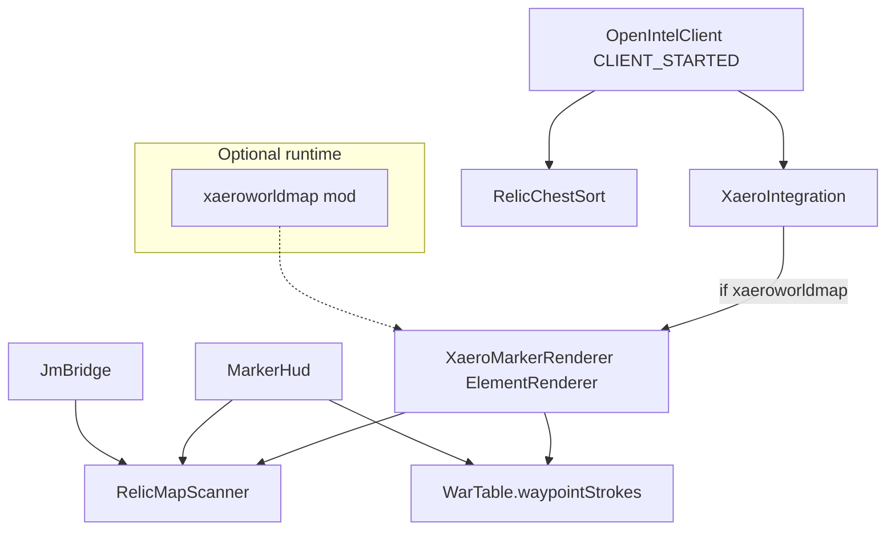

# OpenIntel fork → upstream port guide

This document describes what this fork changes relative to stock OpenIntel `26.2`, and how to re-implement those changes upstream. It is written for a human maintainer **and** an AI coding agent: treat file paths and acceptance criteria as the source of truth.

**Base branch:** GitHub `hiimcapri/openintel` → `26.2` (upstream has no `26.3` branch yet)  
**Working tree:** Minecraft `~26.3`, Java 25, Fabric, official Mojang names  
**Feature delta below:** written against stock `26.2`. Current Xaero compile deps are `xaeroworldmap-common-26.3:1.46.4` and `xaerolib-common-26.3:1.7.17`.  
**Reference implementation:** this working tree (especially `mod/src/main/java/dev/openintel/xaero/`)

---

## 1. Goal (product)

Replace the optional **xaero-world-map-bridge** dependency with a **direct** Xaero's World Map integration, and upgrade relic / pin presentation so Civ+ play is readable without chat spam.

| Area | Stock `26.2` | This fork |
|------|--------------|-----------|
| Xaero dependency | Soft-dep on `xaero_world_map_bridge` + vendored bridge jar | Soft-dep on `xaeroworldmap` only; compile against Xaero World Map + XaeroLib APIs |
| World map markers | Small dots / small diamonds / gold relic diamonds, one-line labels | Larger outlined circles (players), outlined diamonds (snitch/ping/War Table pins), CivWiki relic icons, **two-line** labels |
| Relic detection | `RelicMaps` inventory scan + chat toast on detect / claim via actionbar | `RelicMapScanner` inventory scan only; **no** pickup/detect chat |
| Nearby relic HUD | All inventory relics as gold diamonds at eye height | Only within **`relicMarkerRange`** (default **300**) horizontal blocks; label = name \| enchantment \| distance |
| Chest UX | None | Optional sort of located relic maps closest→furthest in opened chest/barrel/ender/shulker |
| War Table pins | HUD toggle only (`warTablePinMarkers`) | Independent HUD toggle + **world-map** toggle (`warTablePinWorldMap`) |
| Logo / watermark | Already toggleable (`logoHudEnabled`) | Keep as-is (HUD → Elements → OpenIntel logo) |

**Out of scope for this port**

- Drawing on Xaero's **Minimap**
- Writing persistent Xaero waypoints / map files
- Changing JourneyMap except to read the same relic scanner (no second detector)
- Retargeting away from Minecraft 26.2

---

## 2. High-level architecture



**Soft-dep pattern (critical):**

1. `XaeroIntegration` must **not** import any `xaero.*` types at the class that is always loaded.
2. Only `XaeroMarkerRenderer` (and friends) touch Xaero APIs.
3. Call `XaeroIntegration.initialize()` from `ClientLifecycleEvents.CLIENT_STARTED` (same reason as the OpenIntel API: thread identity / other mods not ready during `onInitializeClient`).
4. Registration retries on `END_CLIENT_TICK` until `WorldMap.mapElementRenderHandler` exists; a missing handler is normal early startup, not a hard failure.
5. Catch `LinkageError | RuntimeException` once; set a `failed` flag so a bad Xaero version does not spam or crash the client.

Stock bridge path to **delete** when porting:

- `mod/src/main/java/dev/openintel/xaero/XaeroBridge.java`
- `mod/libs/xaero-world-map-bridge-*.jar`
- `compileOnly files('libs/xaero-world-map-bridge-...')` in `build.gradle`
- `FabricLoader.isModLoaded("xaero_world_map_bridge")` registration in `OpenIntelClient`
- README / AGENTS text that requires the bridge

---

## 3. Gradle / compile setup

In `mod/build.gradle`:

```gradle
repositories {
    maven { url = 'https://chocolateminecraft.com/maven' }
    // keep existing repos (JourneyMap API jars, etc.)
}

dependencies {
    // compile-time only; optional at runtime
    compileOnly("xaero.map:xaeroworldmap-common-26.2:1.46.1") { transitive = false }
    compileOnly "xaero.lib:xaerolib-common-26.2:1.7.7"
}
```

Pinned versions used by this fork:

| Artifact | Version |
|----------|---------|
| Xaero's World Map (API) | `xaeroworldmap-common-26.2:1.46.1` |
| XaeroLib | `xaerolib-common-26.2:1.7.7` |

Optional: Foojay toolchain resolver in `mod/settings.gradle` so CI/dev machines can provision JDK 25 automatically.

Do **not** put Xaero on the runtime classpath of the published mod jar; players install Xaero themselves.

---

## 4. File inventory (copy / adapt from this fork)

### New / restored package

| Path | Role |
|------|------|
| `mod/src/main/java/dev/openintel/xaero/XaeroIntegration.java` | Soft-dep entry; no Xaero imports |
| `mod/src/main/java/dev/openintel/xaero/XaeroMarkerRenderer.java` | `ElementRenderer` for fullscreen World Map |
| `mod/src/main/java/dev/openintel/xaero/MapMarker.java` | Transient marker record (`id, x,y,z, dim, argb, title, label, expiresAt`) |
| `mod/src/main/java/dev/openintel/xaero/RelicMapScanner.java` | Inventory → markers |
| `mod/src/main/java/dev/openintel/xaero/RelicMapMath.java` | Explorer-map coordinate math |
| `mod/src/main/java/dev/openintel/xaero/RelicCatalog.java` | Relic name → enchantment + texture |
| `mod/src/main/java/dev/openintel/xaero/RelicNames.java` | Parse tooltip/lore lines |
| `mod/src/main/java/dev/openintel/xaero/RelicProximity.java` | Configurable-range HUD pin helper (default 300) |
| `mod/src/main/java/dev/openintel/xaero/RelicChestSort.java` | Container click planner |
| `mod/src/main/java/dev/openintel/xaero/RelicMapOrder.java` | Slot exchange plan |
| `mod/src/main/resources/assets/openintel/textures/relic/*.png` | CivWiki-style icons |
| `mod/src/test/java/dev/openintel/xaero/MapMarkerTest.java` | Visibility / expiry |
| `mod/src/test/java/dev/openintel/xaero/RelicMapMathTest.java` | Coord math |

### Delete when porting onto stock 26.2

| Path | Why |
|------|-----|
| `.../xaero/XaeroBridge.java` | Bridge overlay API |
| `.../relic/RelicMaps.java` | Chat toast detector + parallel active set |
| `.../mixin/OverlayMessageMixin.java` | Claim hook for RelicMaps |
| `.../RelicMapNameTest.java` | Tests RelicMaps only |

### Touch points in existing code

| Path | Change |
|------|--------|
| `OpenIntelClient.java` | `XaeroIntegration.initialize()` on `CLIENT_STARTED`; tick `RelicChestSort`; clear `RelicMapScanner` on join/leave; remove RelicMaps / bridge register |
| `MarkerHud.java` | Relic pass via `RelicMapScanner` + `RelicProximity`; keep War Table HUD gated by `warTablePinMarkers` |
| `JmBridge.java` | Relic overlays from `RelicMapScanner.markers(...)` |
| `OIConfig.java` | `xaeroRelicMaps`, `sortRelicMaps`, `warTablePinWorldMap` (+ migration defaults) |
| `ClickGui.java` + `en_us.json` | Settings labels / tooltips |
| `build.gradle` | Chocolate maven + Xaero compileOnly; drop bridge jar |
| `mapFontTest` | Assert `XaeroMarkerRenderer.label` scopes `UiFont.withMapFont("openintel", ...)` |

---

## 5. Xaero World Map renderer (how it works)

### Registration

```java
// XaeroMarkerRenderer
static boolean registerWhenReady() {
    var handler = WorldMap.mapElementRenderHandler;
    if (handler == null) return false;
    handler.add(new XaeroMarkerRenderer());
    return true;
}
```

Key overrides:

- `shouldRender` → `ElementRenderLocation.WORLD_MAP` and `!shadow` only (never minimap)
- `shouldBeDimScaled()` → `false` (coords already belong to the viewed dimension)
- `getOrder()` → `100`
- `preRender` builds a fresh `List<MapMarker>` snapshot for `info.mapDimension`
- `renderElement` draws icon + two-line plate; returns `false` (non-interactive)

### Marker kinds and visuals

| `id` prefix | Icon | Title (line 1) | Label (line 2) |
|-------------|------|----------------|----------------|
| `player:` | Filled circle radius ~5 with dark outline | Player name | `123m` and/or `via reporter` |
| `snitch:` | Outlined diamond (±5 px) | `Snitch: {name}` | `{player} (via {reporter})` |
| `ping:` | Outlined diamond | `Ping: {label}` | sender |
| `relic:` | 16×16 (or atlas size) texture from `textures/relic/`, dark backing; fallback gold `X` | Relic name | Enchantment, else `x, z` |
| `wartable:` | Outlined diamond (pin color) | Pin label / author fallback | `x, z` |

Drawing notes agents often miss:

1. **Circles / diamonds** are fill strips via `MapElementGraphics.fill`, not bitmaps.
2. Relic blit **must** use `XaeroRenderType.RP_POSITION_COLOR_TEX_TRANSLUCENT`. `RP_POSITION_TEX_ALPHA` crashes during world-map extract (unset discard-alpha uniform).
3. Text is wrapped in `XaeroMarkerRenderer.label(Runnable)` → `UiFont.withMapFont("openintel", ...)`. Only the label helper scopes the clean font; the rest of `renderElement` must not call `withMapFont` (enforced by `mapFontTest`).
4. Plate: dark backing `0xB0101014`, title tinted with marker ARGB, subtitle white.
5. Render boxes are taller for relics (`top -10`, `bottom 34`) so icons + two lines fit.

### Snapshot sources

Controlled by config:

- `xaeroMarkers` → shared players, snitch hits, pings
- `xaeroRelicMaps` → `RelicMapScanner.markers(client)`
- `warTablePinWorldMap` → `WarTable.waypointStrokes()` where `tool == MARKER`, Overworld only

Players: if the entity is loaded in the viewed dimension, use lerped live position; otherwise last relay report. Skip self. Expiry: `lastSeen + staleAfterMs` (snitches / pings use their own lifetimes; relics / pins use `Long.MAX_VALUE` while present).

---

## 6. Relic maps (Civ+)

### Game facts

- Item display name is usually **"Treasure Map"**.
- Relic identity is in lore (and sometimes decoration name), matched against `RelicCatalog`.
- Maps last only while carried; claiming at the site turns the map into the relic item.
- Coordinates may appear as absolute `MAP_DECORATIONS` world X/Z, **or** as map-icon bytes relative to map center (vanilla explorer-map math in `RelicMapMath`).
- Until the player arrow is on the map, center may be unknown → log once, show nothing yet. **No chat.**

### Scanner responsibilities

`RelicMapScanner`:

1. Walk player inventory + carried stack; recurse into containers/bundles (depth ≤ 4).
2. Prefer decoration entries with finite world X/Z.
3. Else resolve map center from an interior `player` decoration, then convert icon bytes → world.
4. Emit `MapMarker` ids `relic:{mapId}:{iconKey}`, color `0xFFE8B84A`, dim `minecraft:overworld`, Y = `64` (maps have no height).
5. Clear on world unload / disconnect.

Shared consumers: Xaero renderer, MarkerHud proximity pins, JourneyMap bridge, chest sorter (`blockPos`).

### Nearby HUD

In `MarkerHud`, for Overworld only:

- If horizontal distance ≤ `cfg.relicMarkerRange` (default **300**), add a target at player eye-height column `(relicX, playerY+1.5, relicZ)`.
- Label: `RelicProximity.label(title, subtitle) + " | " + meters + "m"`.
- Uses existing diamond shape path (kind `1`) and pin opacity group.

### Chest sort

`RelicChestSort.tick` when `sortRelicMaps` is on and a chest/barrel/ender/shulker screen is open: plan swaps so located relic maps order closest→furthest; non-relic slots stay put. Uses vanilla container clicks only.

### Remove RelicMaps behavior

Do **not** keep:

- `OpenIntelClient.status("relic map detected: ...")`
- Actionbar `"found a relic"` claim hook that removes markers
- A parallel `active` / `claimed` set separate from inventory truth

Inventory presence is the sole source of truth.

---

## 7. Settings / config

| Field | Default | UI | Behavior |
|-------|---------|-----|----------|
| `logoHudEnabled` | `true` | HUD → OpenIntel logo | Bottom-right watermark; already in stock 26.2 — keep |
| `xaeroMarkers` | `true` | Integrations → Xaero World Map markers | Players / snitches / pings on World Map |
| `xaeroRelicMaps` | `true` | Integrations → Relic maps | Inventory relics on World Map |
| `sortRelicMaps` | `true` | Integrations → chest sort | Closest-first in containers |
| `warTablePinMarkers` | `true` | War Table → HUD pins | In-world HUD waypoints (the “X vault” style pins) |
| `warTablePinWorldMap` | `true` | War Table → pins on world map | Same strokes on Xaero World Map |
| `warTablePinOpacity` | `150` (30–150) | War Table → opacity | Shared opacity for static pin-like HUD marks |

Migration: if JSON lacks `xaeroRelicMaps` / `sortRelicMaps` / `warTablePinWorldMap`, default them `true` and save once (same pattern as existing OIConfig migrations).

Lang keys (examples):

- `options.openintel.wartable.pin_markers` — clarify **HUD**
- `options.openintel.wartable.pin_world_map` — world map
- `options.openintel.xaero.relic_maps`, `options.openintel.relic.sort_chest`

---

## 8. Suggested agent implementation order

1. **Gradle:** Chocolate maven + Xaero compileOnly; delete bridge jars/deps.
2. **Copy** the `xaero/` package + `textures/relic/` + unit tests from this fork.
3. **Wire** `OpenIntelClient`: `CLIENT_STARTED` → `XaeroIntegration.initialize()`; tick chest sort; clear scanner; remove RelicMaps/bridge.
4. **Delete** `RelicMaps`, `OverlayMessageMixin`, bridge class; fix mixins JSON.
5. **MarkerHud:** swap relic gather to scanner + proximity; leave chevron/diamond geometry alone.
6. **JmBridge:** point relics at scanner.
7. **Config + ClickGui + lang** for the three new/changed toggles.
8. **Tests:** `mapMarkerTest`, `relicMapTest` on `check`; update `mapFontTest` for `XaeroMarkerRenderer.label`; drop `relicMapNameTest`.
9. **Docs:** README Xaero section must say World Map only, no bridge.
10. **`./gradlew build`** from `mod/`.

---

## 9. Acceptance criteria (manual + automated)

### Automated

- [ ] `./gradlew build` passes including `mapMarkerTest`, `relicMapTest`, `mapFontTest`
- [ ] No compile/runtime dependency on `xaero_world_map_bridge`
- [ ] Soft-dep: client starts with Xaero absent
- [ ] Soft-dep: client starts with Xaero present; log line `Xaero World Map markers enabled` once handler registers

### In-game (Xaero World Map 1.46.x)

- [ ] Fullscreen map (`M`): allegiance-colored **circles** for remote players with name + distance/via
- [ ] Snitch / ping: **diamonds** + two-line plates (not tiny bridge diamonds)
- [ ] Relic maps in inventory: CivWiki icons + name + enchantment (or coords); Overworld only; disappear when map leaves inventory
- [ ] No chat toast when picking up / detecting a relic map
- [ ] Within `relicMarkerRange` (default ~300 blocks) of a relic column: HUD pin with name / enchantment / distance
- [ ] War Table MARKER strokes: hide independently on HUD vs World Map via the two toggles
- [ ] Minimap unchanged (no OpenIntel markers)
- [ ] No new entries in Xaero's saved waypoint list

### Settings

- [ ] Logo toggle still works (bottom-right)
- [ ] Relic maps / chest sort / xaero markers / war table HUD pins / war table world-map pins all persist across restart

---

## 10. Pitfalls

1. **Calling Xaero APIs from always-loaded classes** → hard crash without Xaero. Keep the split (`XaeroIntegration` vs `XaeroMarkerRenderer`).
2. **Registering only once at `CLIENT_STARTED`** → handler often null; must retry on tick.
3. **Nether dimension scaling** → leave `shouldBeDimScaled()` false.
4. **Wrong blit render type** → use `RP_POSITION_COLOR_TEX_TRANSLUCENT`.
5. **Reintroducing RelicMaps chat** → violates this fork's UX; inventory scan is enough.
6. **Merging bridge + direct renderer** → duplicate markers; pick one (this fork: direct only).
7. **Assuming “minimap integration”** → this work is World Map fullscreen only.
8. **War Table pins** are `Stroke.Tool.MARKER` from the relay/local War Table layer — not snitch hits and not Xaero waypoints.

---

## 11. Quick reference: key constants

```text
relicMarkerRange         = 300 blocks default (horizontal; 50–2000)
RelicMapMath.OVERWORLD   = "minecraft:overworld"
RelicMapMath.MARKER_Y    = 64
RelicMapMath.COLOR        = 0xFFE8B84A
Xaero element order      = 100
Player circle radii      = outer 5 / inner 3
Diamond half-width       = 5 (dark outline one px larger)
Relic icon draw          = 16×16 blit, backing -9..9
Label plate              = height 22 px under icon
```

---

## 12. Where to copy from

If this guide is used outside the fork repo, ask for a snapshot of:

- `mod/src/main/java/dev/openintel/xaero/**`
- `mod/src/main/resources/assets/openintel/textures/relic/**`
- `mod/src/test/java/dev/openintel/xaero/**`
- Diffs to `OpenIntelClient`, `MarkerHud`, `JmBridge`, `OIConfig`, `ClickGui`, `en_us.json`, `build.gradle`, `openintel.mixins.json`, `MapFontTest`

That set is sufficient for an agent to port without inventing a second architecture.
